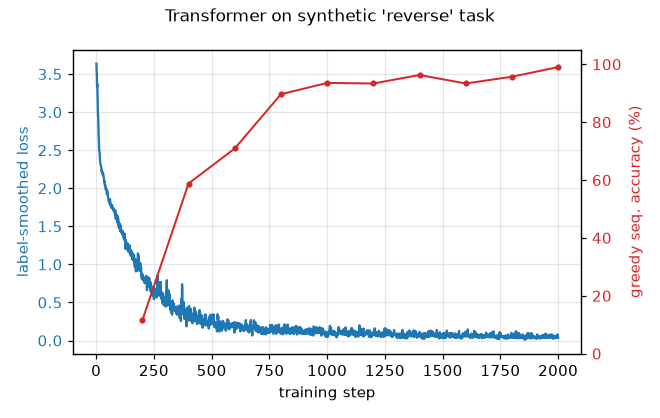
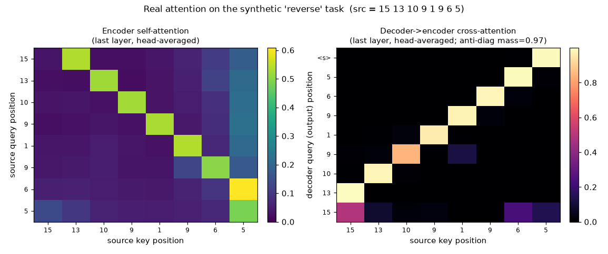
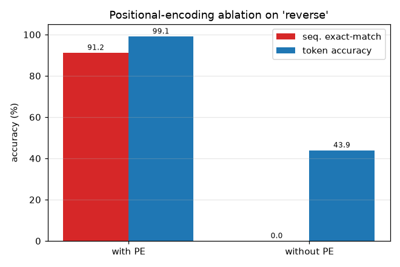
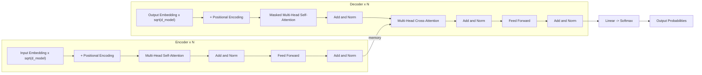

# Details — Transformer from Scratch

Long-form evidence and notes moved out of the short [README](../README.md).
Every synthetic-task number here was measured by running the scripts in this
repo on a laptop CPU (Apple Silicon, no GPU) with the default seed (`1234`).
Reruns reproduce them (fixed seeds, deterministic on CPU). Paper figures
(BLEU 27.3, ≈65 M params) are quoted from the paper, not measured here.
Parameter counts come from instantiating the model, not from a training run.

## 1. Main run: synthetic `reverse` task

The model must **reverse** a variable-length sequence of symbols, for example
`5 14 6 13 11 15 0` → `0 15 11 13 6 14 5 <eos>`. The task needs both *content*
and *position*, so it exercises the embeddings, both mask types, cross-attention
and the auto-regressive decode.

Model: **d_model=128, 4 heads, 2+2 layers, ≈0.66 M params** (664,979 exactly).
Training: **2000 steps**, batch 64.

| Metric | Value |
|--------|-------|
| Teacher-forced token accuracy | **0.9981** |
| Greedy free-running exact-match (sequence) accuracy | **0.9824** |
| Final label-smoothed train loss | **0.0507** |
| Wall-clock training time | ~75–90 s on CPU (Apple Silicon, no GPU) |

Command (also regenerates `assets/loss_curve.png`):

```bash
python scripts/train_synthetic.py --task reverse --steps 2000 --device cpu
```



Sample held-out predictions (greedy decode; `OK` = exact match):

```
OK  src=1 9 6 5 3 9 11 4
    gold=4 11 9 3 5 6 9 1 <eos>
    pred=4 11 9 3 5 6 9 1 <eos>
OK  src=15 15 12 3 4 5 2 13 6 1
    gold=1 6 13 2 5 4 3 12 15 15 <eos>
    pred=1 6 13 2 5 4 3 12 15 15 <eos>
OK  src=11 12 8 5 14 14 5 14 7 1 4
    gold=4 1 7 14 5 14 14 5 8 12 11 <eos>
    pred=4 1 7 14 5 14 14 5 8 12 11 <eos>
OK  src=15 11 10 14 9 5 3 13 14 8 1
    gold=1 8 14 13 3 5 9 14 10 11 15 <eos>
    pred=1 8 14 13 3 5 9 14 10 11 15 <eos>
OK  src=5 14 6 13 11 15 0
    gold=0 15 11 13 6 14 5 <eos>
    pred=0 15 11 13 6 14 5 <eos>
```

Other tasks (`copy`, `sort`) use the same script:

```bash
python scripts/train_synthetic.py --task copy --steps 1500
python scripts/train_synthetic.py --task sort --steps 3000
```

Run `python scripts/train_synthetic.py --help` for all flags (model size,
batch, warmup, etc.).

## 2. Experiments (attention map and ablation)

Two small, seeded, CPU-only experiments (≈2 min total). Both figures are
regenerated by one command:

```bash
python scripts/experiments.py --steps 1200 --warmup 200 --device cpu
```

Note: these experiments use a **1200-step** run, so their accuracy differs
from the 2000-step main run above.

### 2a. What does the model attend to?

After training on `reverse`, one held-out example goes through the model. The
attention weights cached on each head (`MultiHeadAttention.last_attn`) are read
back and plotted. There is no surrogate and no re-derivation.



For the source `15 13 10 9 1 9 6 5`, the decoder→encoder cross-attention (right
panel) sits almost entirely on the *anti-diagonal*: output position `t` reads
source position `L−1−t`. The model solves `reverse` by scanning the source
back-to-front. Measured fraction of cross-attention mass on the anti-diagonal:
**0.97**. The encoder self-attention (left panel) is close to a content
diagonal with extra mass on the final token.

### 2b. Does positional encoding matter? (ablation)

The same model is trained twice on `reverse` with **identical seeds, weight
init, and data stream**: once with sinusoidal positional encoding and once with
it removed (the `pos_encoding` module is swapped for a no-op; no library code
changes). Without position information the encoder is permutation-invariant, so
a position-only task like `reverse` should collapse.

| Arm | Token accuracy | Sequence exact-match |
|-----|----------------|----------------------|
| **with** positional encoding | **0.9909** | **0.9121** |
| **without** positional encoding | 0.4393 | **0.0000** |



Result (as measured): removing positional encoding drops sequence exact-match
from **91.2% → 0.0%**. The model never gets one full reversal right. Token
accuracy only falls to **43.9%** (well above the ~6% chance for 16 symbols).
Without order information the model still learns *which* symbols appear (the
multiset) and emits `<eos>` at the right length. The decoder's causal mask also
leaks a weak position signal. But it never learns the *order*, which is exactly
what `reverse` requires. So positional encoding is load-bearing for this task,
not decorative.

## 3. Architecture



Component → file map (see [`paper_notes.md`](../paper_notes.md) for the
section/equation mapping):

- **Scaled dot-product attention** (paper Eq. 1) — `transformer/attention.py`
- **Multi-head attention** (paper §3.2.2) — `transformer/attention.py`
- **Sinusoidal positional encoding** (paper §3.5, `register_buffer`) — `transformer/positional.py`
- **Position-wise feed-forward** (paper §3.3) — `transformer/feed_forward.py`
- **Encoder layer/stack** (paper §3.1) — `transformer/encoder.py`
- **Decoder layer/stack** (paper §3.1) — `transformer/decoder.py`
- **Padding + causal masks** (paper §3.2.3) — `transformer/masking.py`
- **Full model, embedding scaling, weight tying** (paper §3.4) — `transformer/model.py`
- **Noam LR schedule** (paper Eq. 3) — `transformer/schedule.py`
- **Label-smoothing loss** (paper §5.4) — `transformer/loss.py`

Hyperparameters follow the paper: Adam β=(0.9, 0.98), ε=1e-9, warmup=4000,
label smoothing 0.1. `N`, `d_model` and heads are configurable.

A paper-size base config (`d_model=512, N=6, h=8, d_ff=2048`, shared
37 000-token vocab, tied embeddings) instantiates to ≈63.1 M parameters
(63,119,496 exactly). The paper quotes ≈65 M. The gap comes from embedding
tying and the exact vocabulary size, not from the layer architecture.

## 4. Tests

```bash
pip install pytest ruff
ruff check .
pytest -q
```

The suite has **33 tests** and runs in **~4 s on CPU**. CI runs it on Python
3.11 and 3.12. The tests check:

- attention output shapes, and that a forward pass returns `(B, T, vocab)`;
- the causal mask is strictly lower-triangular (no future leakage);
- multi-head split/merge round-trips exactly;
- positional-encoding shape and values;
- the paper-size parameter count;
- **overfit-one-batch**: the model drives the loss to ~0 and reaches 100% token
  accuracy on a fixed tiny batch. This is the key correctness signal.

## 5. Real translation (EN→DE, Multi30k)

The same model, schedule and loss can train on real data via HuggingFace
`datasets` (`torchtext` is deprecated and intentionally avoided):

```bash
pip install -r requirements.txt -r requirements-translation.txt
python scripts/train_translation.py --epochs 20 --batch-size 128
```

Status: the paper-scale WMT'14 EN→DE BLEU (**27.3**, base model) is the
paper's **target, not a number reproduced on this hardware**. A competitive
BLEU on WMT'14/Multi30k needs a GPU and longer training, which were not used.
`train_translation.py` (paper-size config) was never run to convergence here.
The only measured numbers in this repo are the synthetic-task metrics above.

| Task | Metric | Paper (target) | This repo (measured) |
|------|--------|----------------|----------------------|
| WMT'14 EN→DE (base) | BLEU | 27.3 | not reproduced (no GPU) |
| Synthetic reverse | seq. exact-match acc. | — | **0.9824** |

`scripts/train_translation_small.py` is a second, laptop-sized path (defaults:
`d_model=256`, 4 heads, 3 layers, `d_ff=512`, 15 epochs). It is meant to
measure a real sacrebleu BLEU on the Multi30k test split and write
`results/multi30k_small.json`. **It is provided, but no result exists yet**
(`results/` is empty), so there is no measured small-model BLEU.

## 6. Pinned versions

Results were produced with Python 3.13, `torch==2.12.1`, `numpy==2.5.0`,
`matplotlib==3.11.0` (CPU; no GPU required). CI runs the test suite on Python
3.11 and 3.12; `pyproject.toml` allows Python >=3.10.

## 7. Project structure

```
attention_is_all_you_need/
├── transformer/                    # the from-scratch model package
│   ├── attention.py                # ScaledDotProductAttention, MultiHeadAttention
│   ├── positional.py               # sinusoidal PositionalEncoding (register_buffer)
│   ├── feed_forward.py             # PositionwiseFeedForward
│   ├── encoder.py                  # EncoderLayer, Encoder
│   ├── decoder.py                  # DecoderLayer, Decoder
│   ├── masking.py                  # padding + causal (look-ahead) masks
│   ├── model.py                    # Transformer assembly + greedy_decode
│   ├── schedule.py                 # Noam warmup LR schedule
│   ├── loss.py                     # label-smoothing KLDiv loss
│   └── config.py                   # TransformerConfig dataclass
├── tasks/
│   └── synthetic.py                # copy / reverse / sort data generator
├── scripts/
│   ├── train_synthetic.py          # the reproducible CPU demo
│   ├── experiments.py              # attention-viz + positional-encoding ablation
│   ├── train_translation.py        # optional EN→DE Multi30k path (paper-size config)
│   └── train_translation_small.py  # small EN→DE Multi30k run (provided; no result yet)
├── tests/                          # pytest suite (33 tests)
├── results/                        # output dir for the small translation run (empty)
├── assets/loss_curve.png           # generated training curve
├── assets/attention_maps.png       # real attention weights (encoder + cross)
├── assets/pe_ablation.png          # positional-encoding ablation bar chart
├── docs/DETAILS.md                 # this file
├── paper_notes.md                  # module → paper section/equation mapping
├── requirements.txt
└── .github/workflows/ci.yml        # ruff + pytest on CPU
```

## 8. Implementation notes / deviations

Design choices and the paper-section mapping live in
[`paper_notes.md`](../paper_notes.md). Short version:

- **No `nn.Transformer`.** Attention, masking, multi-head split/merge and the
  layer stacks are implemented directly.
- **Masks are boolean** (`True` = attend). Masked logits get `-inf` before the
  softmax, with a `nan_to_num` guard for fully-masked rows. This avoids the
  small leakage of a finite `-1e9` additive mask.
- **Embedding scaling & weight tying** follow §3.4: embeddings are scaled by
  `√d_model`, and `tie_embeddings=True` shares the source/target embeddings with
  the output projection.
- **Post-norm by default** (`LayerNorm(x + Sublayer(x))`, as in the paper). A
  **pre-norm** variant is available via `norm_first=True`.
- **Tokenizer.** The synthetic task uses integer symbols (no tokenizer).
  `train_translation.py` uses simple whitespace + lowercase tokenization.
  `train_translation_small.py` uses a simple regex word/punctuation tokenizer.
  The paper uses subword (BPE/word-piece) tokenization.

## References

- Vaswani et al., *Attention Is All You Need*, NeurIPS 2017 —
  [arXiv:1706.03762](https://arxiv.org/abs/1706.03762)
- Rush, *The Annotated Transformer* —
  https://nlp.seas.harvard.edu/annotated-transformer/
- Press & Wolf, *Using the Output Embedding to Improve Language Models*, 2017 —
  [arXiv:1608.05859](https://arxiv.org/abs/1608.05859)
